# ParkPay

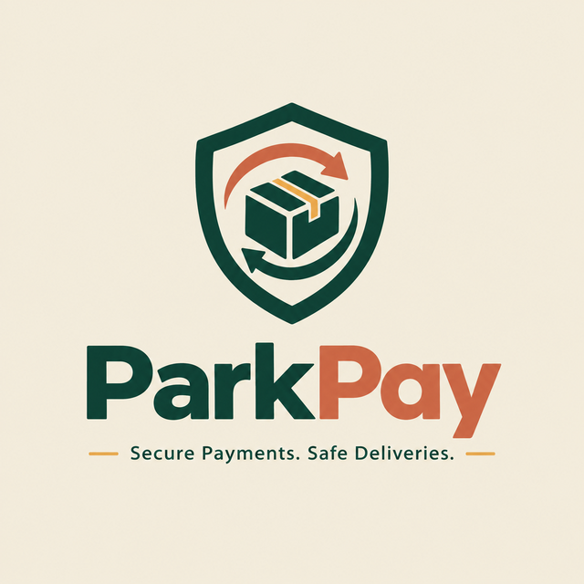

*Secure payments. Safe deliveries.*

Pay-on-delivery for online buyers and sellers, with no middleman holding the money. The buyer's payment is locked in the **seller's own Lightning wallet** and is released only when the buyer sends a secret code. If nothing is delivered, the lock runs out and the money goes back to the buyer automatically.

This version adds accounts and a live dashboard. The seller no longer sends a deal link: they enter the buyer's username, and the deal appears on the buyer's dashboard. Every step updates on both sides in real time.

## The problem

In Nigerian online buying, the most damaging scam is "send money first": the buyer pays and the item never arrives. Most goods between cities travel with park drivers, so a solution cannot depend on riders, apps for drivers, or meeting in person. This project removes that one scam. It does not judge the quality of goods.

## How it works

1. **Sign up.** Each person creates an account with a name, a username and an email. The phone number is optional.
2. **Deal.** The seller enters the buyer's username, the item, the price, the driver's name and phone, and a lock time. The deal appears on the buyer's dashboard; no link is sent.
3. **Lock request.** The buyer's app creates a long random secret code and keeps it encrypted with a PIN. It sends the seller only the code's fingerprint (a SHA-256 hash).
4. **Locked box.** The seller's wallet creates a Lightning *hold invoice* from that fingerprint. The buyer pays it with any Lightning wallet, from the same screen. The money is now locked: nobody can spend it yet.
5. **Shipping.** The seller sees "Payment locked" and sends the package with the driver.
6. **Arrival.** At the park the buyer calls the seller, ticks the handover box and enters the PIN. The app sends the code. The seller's app checks it instantly, confirms the money is still locked, and claims the payment. Only then does the seller tell the driver to release the package.
7. **No delivery.** If the package never arrives, the lock expires or the seller cancels, and the buyer's money returns automatically.

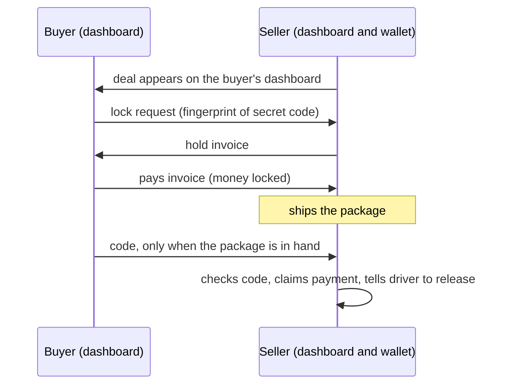

## Architecture

- **React + TypeScript + Vite** static app.
- **Supabase** for accounts, Postgres, row-level security and Realtime.
- **NWC** (Nostr Wallet Connect) for the seller's Lightning wallet. The SDK is loaded on demand, so buyers never download it.

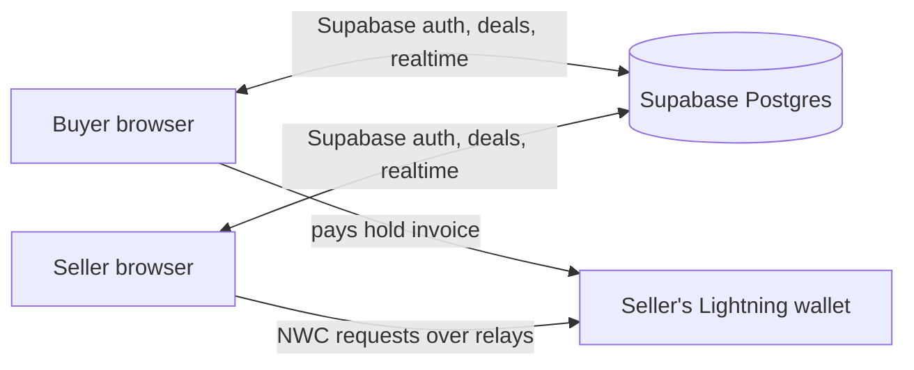

Tables:

- `profiles`: username, name, optional phone.
- `deals`: the parties, terms, state, code fingerprint, invoice, lock expiry, and the released code (cleared after settlement).
- `deal_secrets`: the buyer's encrypted code vault. Only the buyer can read it, so the seller never sees the code before release and the buyer can release from any device.

Row-level security lets only the two parties read a deal. A trigger stops either party from changing the parties or the terms. Realtime publishes deal changes to both dashboards.

The seller's wallet link is stored only encrypted with the seller's PIN. The buyer's code is stored only encrypted with the buyer's PIN. Neither side ever receives the other's wallet link.

## Setup

1. Create a free project at [supabase.com](https://supabase.com).
2. In the SQL editor, run [`supabase/schema.sql`](supabase/schema.sql).
3. In **Authentication → Providers → Email**, turn **Confirm email** off for the demo. (Leave it on for production and add a confirmation screen.)
4. Create `.env.local` in this folder:

   ```
   VITE_SUPABASE_URL=https://your-project.supabase.co
   VITE_SUPABASE_ANON_KEY=your-anon-public-key
   ```

   Use the **anon public** key. Never put the `service_role` key in a browser app.

5. Run it:

   ```
   npm install
   npm run dev
   ```

6. Create two accounts (a seller and a buyer). The seller can use **Try demo mode** for fake money; the buyer needs no wallet.

## Screens

Screenshots from the live two-account demo (phone-sized viewport, demo mode):

| Screen | What it shows |
The name of the platform was initially Oja but changed to PArkPay 
| --- | --- |
| 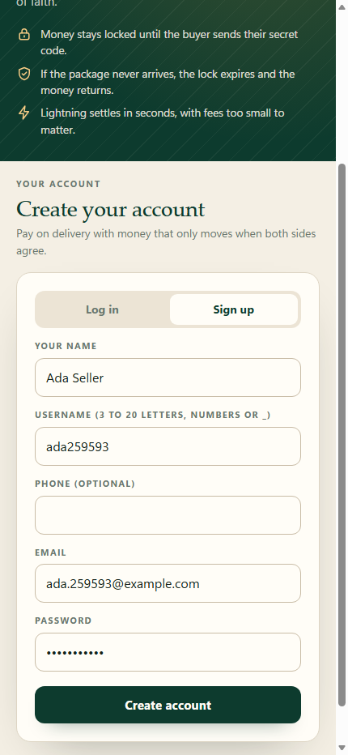 | Sign up with a name, a username and an email. The phone number is optional. |
| 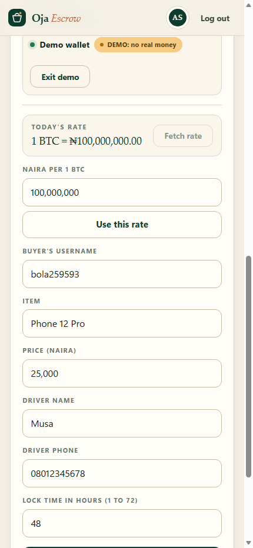 | Seller enters the buyer's username, item, price, driver and lock time. Demo mode uses fake money. |
| 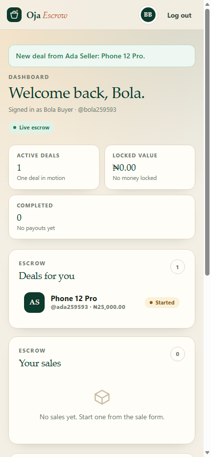 | The deal appears on the buyer's dashboard. No link to open or trust. |
| 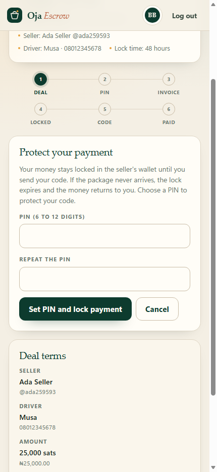 | Buyer sets a PIN. The app creates a random secret code and stores only its fingerprint and an encrypted vault. |
| 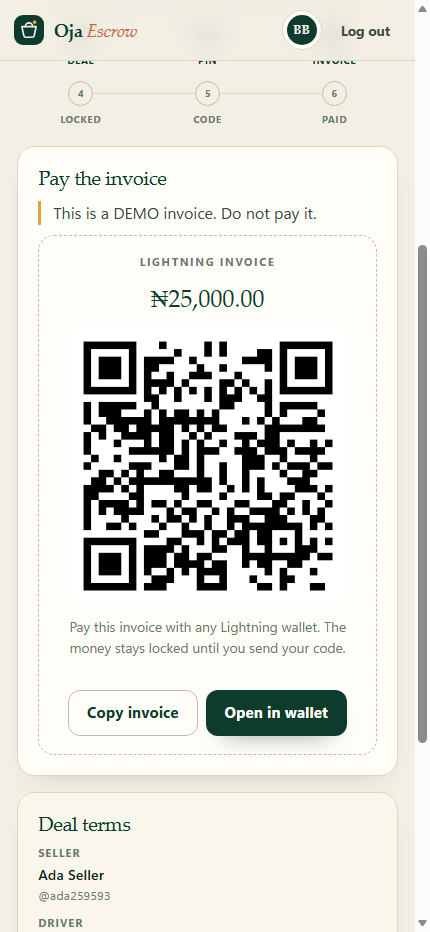 | The seller's hold invoice appears on the same screen, with a QR code. |
| 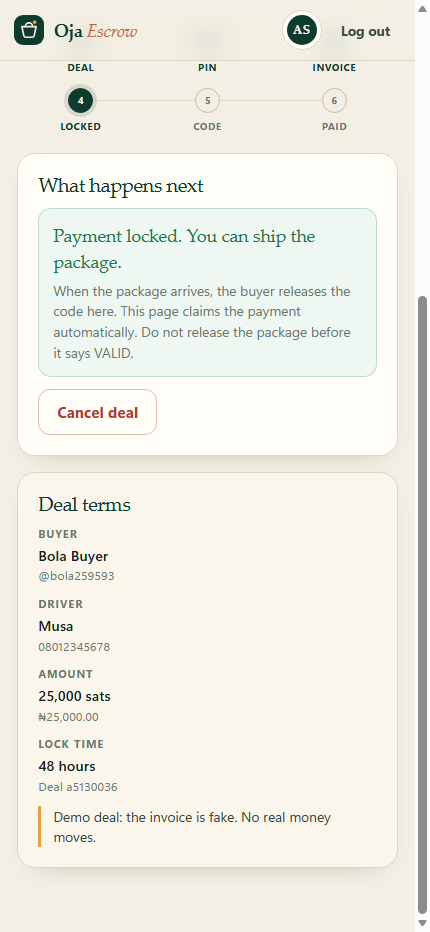 | Seller sees the payment locked live and can hand the package to the driver. |
| 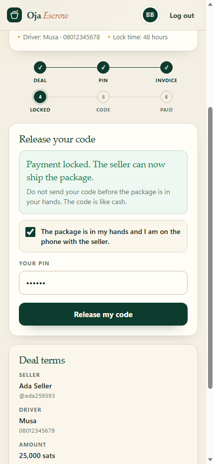 | At handover, the buyer confirms and releases the code. |
| 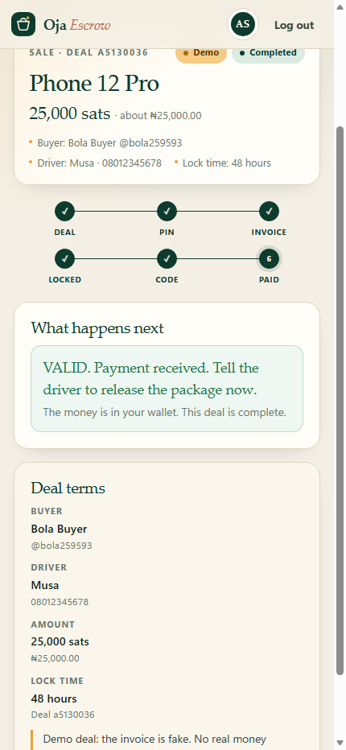 | The seller's app claims the payment automatically. Both dashboards show Completed. |
| 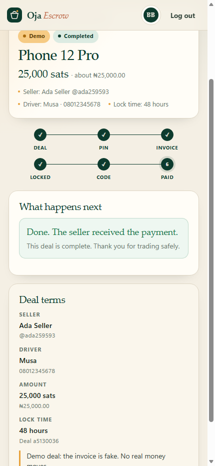 | The buyer sees the completed deal live, without a refresh. |

## What it protects, and what it does not

Protects:
- the buyer, from paying and receiving nothing (the lock returns by itself)
- the seller, from fake payments (the money is locked before shipping) and from a buyer who takes the package and refuses to pay (the code is needed before the driver releases it)

Does not protect:
- bad or wrong goods: after the code is sent the money is gone, and any refund depends on the seller's honesty
- a driver who releases the package early or colludes with someone
- a buyer who reveals the code too early (the app warns, but cannot stop it)

No system removes all trust. This one removes the most common scam and keeps the remaining trust visible. A neutral referee is a planned next step.

## Security notes

- **The code is long and random** (32 bytes), never chosen by a person. A short or chosen code could be guessed by the computers a payment passes through, and the money could be taken.
- **Codes and wallet links are encrypted on the device** with the owner's PIN (PBKDF2 and AES-GCM). A short PIN stops casual access, not a determined attacker who copies the device storage.
- **The seller's app checks three things before releasing:** the code matches the fingerprint, the wallet reports the money is locked right now, and the lock is not about to expire.
- **The database enforces the rules.** Row-level security limits each deal to its two parties. A trigger blocks changes to the parties or the terms. The buyer's code vault is readable only by the buyer.
- **The seller's browser must be open** to create the hold invoice and to claim the payment. This is a browser app, not a server daemon.
- **The app warns** when a wallet connection can also send money, and asks for a connection that can only manage hold invoices.
- No analytics. Account data lives in Supabase; wallet links and codes never leave the browser in plain text.

Not audited. Use small amounts.

## Hosting

`npm run build` produces a static site in `dist/`. Any static host can serve it, but the host must allow the app to reach Supabase.

For a quick deploy, drag the `dist` folder (or a zip of its contents) to [Netlify Drop](https://app.netlify.com/drop). The included `_headers` file applies the headers below on Netlify and Cloudflare Pages. Vercel ignores `_headers`; add the same headers in `vercel.json` if you deploy there.

If the host supports custom headers (for example Netlify or Cloudflare Pages):

```
Content-Security-Policy: default-src 'self'; script-src 'self'; style-src 'self'; img-src 'self' data:; connect-src 'self' https://api.coingecko.com https://*.supabase.co wss://*.supabase.co wss:; base-uri 'none'; form-action 'none'; frame-ancestors 'none'
X-Content-Type-Options: nosniff
Referrer-Policy: no-referrer
Permissions-Policy: geolocation=(), camera=(), microphone=()
```

Add the deployed URL to Supabase **Authentication → URL Configuration** if you enable email confirmation or magic links. For the demo, email/password with confirmation off needs no redirect URL.

GitHub Pages does not allow custom headers. The app still works without them; the headers are an extra layer, not a requirement.

## Limits

- The seller needs a wallet that supports hold invoices through Nostr Wallet Connect (Alby Hub does).
- How long a lock can last depends on the wallet. The tested wallets accepted 48 hours; the maximum was not measured.
- Accounts use email and password. Phone OTP would need a paid SMS provider, so the phone number is only profile information for now.
- The seller's browser must be online to create the invoice and to claim the payment. If the seller is offline when the buyer releases the code, the claim happens when the seller's app comes back, as long as the lock is still valid.
- A username can be looked up by any signed-in user; usernames are public by design.
- The app needs internet to reach Supabase and the wallet relay. It also needs a browser with WebCrypto, which all modern phones have.

## Run it

Requires Node 22.6 or newer (built and tested on Node 26).

```
npm install
npm run dev
```

Create two accounts. As the seller, choose **Try demo mode**: it uses a fake wallet, so the whole flow can be tried with no real money. As the buyer, open the deal from the dashboard, set a PIN, and use the seller's **Simulate buyer payment (demo only)** button instead of paying a real invoice. Other commands: `npm test`, `npm run build`, and `npm run preview` to serve the production build.

## Tests and status

- `npm test` runs 45 automated tests and all 45 pass. They cover the secret code and its check, PIN encryption, money conversion and input formatting, rate parsing, the wait-for-lock logic, the hold-wallet helpers and the demo wallet.
- The two-account demo flow passed end to end in real headless Edge browsers ([`tests/e2e-live.mjs`](tests/e2e-live.mjs)): seller signup, buyer signup, seller creates a deal by username, the buyer sees it live, sets a PIN, the seller's invoice is created automatically, the demo payment locks, the buyer releases the code, and the seller claims the payment automatically. All checks passed with no page errors. Run it with `node tests/e2e-live.mjs http://localhost:5174/` after the app is configured.
- Scripted checks with free Nostr Wallet Connect test wallets that support hold invoices passed on the earlier link-based build, using the same wallet code: the app created a hold invoice, a second wallet paid it, the app showed "Payment locked", the code check returned VALID, the seller settled, and the wallet reported the payment as settled. The cancel path was checked too: the payer's attempt failed with "Hold invoice canceled" and the seller's wallet reported the invoice as cancelled.
- Not covered: the screens have no automated tests beyond the scripted two-account run; the real-wallet checks were scripted, not a formal audit.
- Not audited. Use small amounts.

## AI assistance

This project was drafted with Claude (Anthropic) as a coding assistant. The idea of using hold invoices for pay-on-delivery was suggested by Claude and selected by the author, who made the design decisions about scope and trust. Work continued with opencode, another AI coding assistant. The tests above were run against the final code.
